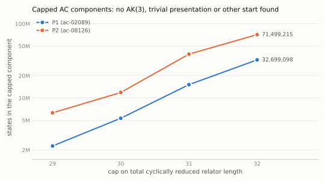
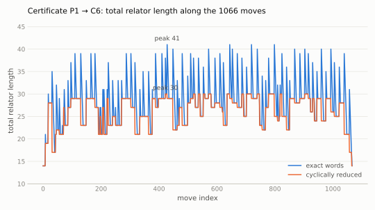
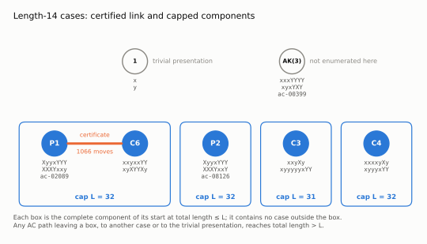

# Andrews–Curtis: two length-14 Miller–Schupp presentations

Status: **computational certificates and search records, not peer reviewed.** First published 2026-09-30.
**Produced by AI models** under the direction of the repository owner; see [`AI_DISCLOSURE.md`](AI_DISCLOSURE.md).

> [!IMPORTANT]
> This repository is a public, timestamped, AI-produced **warrant** for the AC-equivalence of P1 = MS(2, $`x^{-2}y^{-1}x^{2}y`$)
> (J. Carreras, arXiv:2607.23611) and the presentation C6 below: a machine-checked move sequence that no human has yet
> digested. The capped exhaustive searches (results 2, 3) are evidence from a program that is tested, including an
> independent cross-check (`crosscheck/`) and an independent closure check of the largest components (`closure/`),
> but not verified; they are not a proof. We do not regard the questions about
> these presentations as settled by this work. Independent verification and human-readable expositions are welcome,
> and credit for a human-readable proof belongs to whoever writes one. To refer to the computational results, please
> cite the archived repository ([10.5281/zenodo.23196601](https://doi.org/10.5281/zenodo.23196601)). Questions, checks
> and corrections: [GitHub issues](https://github.com/alejandrozarco/andrews-curtis-ms14/issues).

Archived on Zenodo: [10.5281/zenodo.23196601](https://doi.org/10.5281/zenodo.23196601) (all versions). Cite with
`CITATION.cff`.

Related: the same search engine, run on all 2,672 SAIR ACC problems unsolved on 2026-09-30 (peak lower bounds and
groups of problems that are AC-trivial together), is in
[andrews-curtis-sair-census](https://github.com/alejandrozarco/andrews-curtis-sair-census)
([10.5281/zenodo.24024379](https://doi.org/10.5281/zenodo.24024379)).

Presentations (relators as words; capital letters are inverses, `X` = $`x^{-1}`$):

| name | relators | SAIR ACC id |
|---|---|---|
| P1 = MS(2, $`x^{-2}y^{-1}x^{2}y`$) | `XyyxYYY`, `XXXYxxy` | ac-02089 |
| P2 = MS(2, $`x^{-2}y^{-1}x^{2}y^{-1}`$) | `XyyxYYY`, `XXXYxxY` | ac-08126 |
| C6 | `xxyxxYY`, `xyXYYXy` (i.e. $`x^2yx^2y^{-2}`$, $`xyx^{-1}y^{-2}x^{-1}y`$) | — |
| C3 | `xxyXy`, `xyyyyyxYY` (i.e. $`x^2yx^{-1}y`$, $`xy^5xy^{-2}`$) | — |
| C4 | `xxxxyXy`, `xyyyxYY` (i.e. $`x^4yx^{-1}y`$, $`xy^3xy^{-2}`$) | — |
| AK(3) | `xxxYYYY`, `xyxYXY` | ac-00399 |

## Results

1. **P1 and C6 are AC-equivalent.** `certs/P1_equiv_C6.json` lists 1066 elementary AC moves from P1 to a presentation
   in the swap/inversion/cyclic-rotation orbit of C6 (peak total relator length 41 as exact words).
   `python3 verify.py certs/P1_equiv_C6.json` replays it.
2. **Exhaustive search.** For each start P1, P2, the set of presentations reachable by AC moves without the total
   relator length (cyclically reduced) exceeding a cap $`L`$ was enumerated completely, for $`L = 29,\dots,32`$
   (search model and its completeness condition below).
   None of these sets contains AK(3), the other start, or the trivial presentation (the P1 sets contain C6).
   So, under this search model, any AC path from P1 or P2 to AK(3), to each other, or to the trivial presentation
   reaches total length $`\ge 33`$.

| start | cap 29 | cap 30 | cap 31 | cap 32 |
|---|---|---|---|---|
| P1 | 2,267,706 | 5,349,664 | 15,165,074 | 32,699,098 |
| P2 | 6,331,998 | 11,889,832 | 39,047,968 | 71,499,215 |

(states, counted up to relator swap, inversion, cyclic rotation and the 8 signed letter permutations; `runs/*.log`;
conjugator bound $`K = 8`$ for caps 29–31 and $`K = 9`$ for cap 32, `runs/exh_P1_c32_k9.log`, `runs/exh_P2_c32_k9.log`).

Correction (2026-09-30): the first version used $`K = 8`$ at cap 32, which the completeness condition below does not
cover. The cap-32 runs were repeated with $`K = 9`$ and give the same components (same state counts, level by level);
the $`K = 8`$ logs are kept as `runs/exh_P1_c32.log`, `runs/exh_P2_c32.log`.

3. **Same enumeration from C3 and C4** (with C6, residual length-14 classes of github.com/nahomar/andrews-curtis-solver).
   None of these sets contains AK(3), P1, P2, C6, the other start, or the trivial presentation.

| start | cap 29 | cap 30 | cap 31 | cap 32 |
|---|---|---|---|---|
| C3 | 25,978,085 | 58,196,612 | 199,184,986 | — |
| C4 | 269,500 | 627,909 | 1,544,676 | 3,657,734 |

($`K = 8`$, and $`K = 9`$ at cap 32; `runs/exh_C3_*.log`, `runs/exh_C4_*.log`. C3 at cap 31 was run with `acsearch_lean`,
added 2026-11-10, and repeated with `acsearch` for the closure check below, with the same count and the same
distribution by total length; at cap 32 the C3 run exceeded its budget of 250M states, `runs/exh_C3_c32_k9.log`.)
So, under the search model, any AC path from C3 to AK(3), P1, P2, C4, C6 or the trivial presentation reaches total length
$`\ge 32`$, and from C4 to AK(3), P1, P2, C3, C6 or the trivial presentation, $`\ge 33`$.

## Figures

Regenerate with `python3 figures/make_figures.py` (matplotlib), from `runs/*.log` and `certs/P1_equiv_C6.json`
(only complete runs whose conjugator bound meets the completeness condition are used).

<picture>
  <source media="(prefers-color-scheme: dark)" srcset="figures/search_growth_dark.svg">
  
</picture>

Size of the capped components (result 2), log scale.

<picture>
  <source media="(prefers-color-scheme: dark)" srcset="figures/certificate_profile_dark.svg">
  
</picture>

Total relator length along the certificate of result 1, as exact words and cyclically reduced.

<picture>
  <source media="(prefers-color-scheme: dark)" srcset="figures/hard_cases_dark.svg">
  
</picture>

Certified link (result 1) and completely enumerated capped components (results 2, 3). An AC path from a case to any
case outside its box, or to the trivial presentation, reaches a total length above the cap of the box.

## Search model (for result 2)

`acsearch.cpp`: states are unordered pairs of cyclically reduced words modulo rotation, inversion, swap and the
signed letter permutations $`\varphi`$; moves $`u \leftarrow \mathrm{CR}(\mathrm{rot}_i(u)\, c\, \mathrm{rot}_j(v^{\pm1})\, c^{-1})`$
for all rotations and junction-free conjugators $`c`$ of length $`\le K`$. This graph contains the projection of the
elementary AC graph at cap $`L`$ provided $`K \ge \lfloor (L - m)/2 \rfloor`$, where $`m`$ is the minimum total length of a state in the
component (an exact state $`(a u a^{-1}, b v b^{-1})`$ projects to $`\{u, v\}`$, and a multiplication projects to the
move with $`c = a^{-1}b`$, $`|c| \le |a| + |b| \le (L - |u| - |v|)/2`$). Here $`m = 14`$, so $`K = 8`$ suffices for
$`L \le 31`$ and $`K = 9`$ is used for $`L = 32`$. The $`\varphi`$-quotient is justified by explicit AC paths from AK(3) to each
$`\varphi(\mathrm{AK}(3))`$ (`certs/phi/`, checked by `verify.py`). Validation: the rotation-only variant reproduces the
component sizes 680,700 (P1) and 1,880,041 (P2) at cap 28 reported in github.com/nahomar/andrews-curtis-solver;
`validate_projection.py` checks the projection claim on random elementary walks with a negative control.
The completeness of the enumeration rests on this code; it is not formally verified (see the cross-check below).

## Independent cross-check of the enumeration

`crosscheck/crosscheck.py` (Python, no code shared with `acsearch.cpp` apart from decoding its `--dump` key format)
tests the enumeration on smaller caps, against `acsearch --dump` output:

- **Q** (own quotient search): breadth-first search over the same classes, but with all reduced conjugators
  $`c`$, $`|c| \le (L - |u| - |v|)/2`$ (not only junction-free ones), and an independent canonical form.
- **E** (exact graph): breadth-first search of the full exact-word component under the 14 moves of the SAIR ACC
  verifier (`verifier.core.apply_move`, imported), each state projected to its class; every projected class must lie
  in the acsearch component.

| start | Q: cap, classes (equal to acsearch) | E: cap, exact states, projected classes (all inside acsearch's) |
|---|---|---|
| P1 | 24, 17,718 | 20, 1,219,064, 473 |
| P2 | 24, 21,932 | 20, 696,024, 521 |
| C3 | 22, 16,181 | — |
| C4 | 24, 3,492 | 20, 338,336, 117 |
| C6 | 24, 3,736 | 20, 408,072, 136 |
| AK(3) | 21, 18,118 | 17, 857,808, 257 |

Negative control: against acsearch run without conjugator moves ($`K = 0`$) at cap 24, Q finds 118 classes that
acsearch lacks, for P1 and for P2, so Q detects missing conjugator moves. Up to cap 22 the conjugator moves add no
classes for P1 and P2, so the cap-20 E tests check the inclusion but cannot detect missing conjugator moves. Q and E
share the canonical form `klass()`. These tests cover caps up to 24; the largest components of results 2 and 3 are
checked by `closure/` (next section).

`crosscheck/results.txt` has the output; `crosscheck/README.md` the commands.

## Independent closure check of the largest components

`closure/closure_check.cpp` (C++, written from the definitions and SAIR's move semantics without reading the source of
`acsearch.cpp`; added 2026-11-10; small post-review fixes are listed in `closure/README.md`) reads a component dumped by
`acsearch --dump` and checks with its own canonical form and move generation that the set contains the start and is
closed under every move whose result stays within the cap. `closure/README.md` proves that such a set contains the
projection of the whole exact capped component under SAIR's 14 moves, so any class outside it is unreachable within the
cap; the proof does not use the junction-free conjugator claim or the bound on $`K`$ of the search model.

| start | cap | classes (equal to the published counts) | move results examined | outside the set | result |
|---|---|---|---|---|---|
| P1 | 32 | 32,699,098 | 197,618,123 | 0 | PASS |
| P2 | 32 | 71,499,215 | 461,215,820 | 0 | PASS |
| C3 | 30 | 58,196,612 | 520,999,540 | 0 | PASS |
| C3 | 31 | 199,184,986 | 1,817,634,989 | 0 | PASS |
| C4 | 32 | 3,657,734 | 22,443,046 | 0 | PASS |

The trivial presentation, AK(3), P1, P2, C3, C4 and C6 were checked for membership: each set contains its start, the P1
set also contains C6, and no set contains any of the others. Tests at small caps are in `closure/README.md` and
`closure/test_log.txt`: equality with the exact SAIR component by breadth-first search at caps 14–22, including a short
start where conjugators up to length 5 occur, and negative controls that must and do fail (dumps with the conjugator
bound cut short, with one class removed, or checked at a higher cap). The C3 cap-31 check (added 2026-11-13) used a
dump from `acsearch` with one line changed to sort the keys in place, which lowers peak memory to about 6 GB; the
result does not depend on which program wrote the dump. The dumps themselves (0.06–3.2 GB each) are not stored;
`closure/run_large.sh` regenerates and checks them (about 6 hours on one thread), and each file in `closure/results/`
ends with the sha256 of the checker source and of the dump.

## Independent replay with the SAIR ACC reference implementation

`sair_check/` converts every certificate in `certs/` (P1 ~ C6, and the five certificates accompanying Carreras,
arXiv:2607.23611, from github.com/joe-carr-data/ac-certificates, in `certs/carreras/`) to the move format of github.com/SAIRcompetition/Andrews-Curtis (commit `a0fd6e6`) and replays
it with that repository's `verifier.core.apply_move` from its official initial relators; all end states agree with
`verify.py` (`sair_check/generated/report.json`). The official verifier only accepts trivialisations, so it reports
`E_NOT_TARGET` for these equivalence certificates, as expected.

## Reproduce

```sh
python3 verify.py --selftest
python3 verify.py certs/P1_equiv_C6.json certs/carreras/*.json certs/phi/*.json
c++ -O2 -std=c++17 -o acsearch acsearch.cpp     # see the header of acsearch.cpp for options
git clone https://github.com/SAIRcompetition/Andrews-Curtis sair-ac
SAIR_REPO=sair-ac python3 sair_check/check_all.py
SAIR_REPO=sair-ac crosscheck/run_crosscheck.sh ./acsearch xc-run   # ~30 min; xc-run/results.txt, DONE or FAIL
ACSEARCH=./acsearch closure/run_tests.sh > closure-tests.txt 2>&1   # small-cap tests of closure_check
ACSEARCH=./acsearch closure/run_large.sh                          # ~6 h; rewrites closure/results/
```

Python 3.9+, no third-party packages for `verify.py`. The cap-32 enumerations need ~2 GB and 20–30 min per start
(`acsearch_lean.cpp` is the lower-memory variant).

## Inputs in `runs/`

`runs/*.log` are the enumeration logs. `runs/P1_to_C6_c30.paths` (the chain behind `certs/P1_equiv_C6.json`, from
`acsearch` at cap 30, $`K = 8`$, stopped at the first hit) and `runs/ak3_phi_c20.paths` (chains for `certs/phi/`, from
`acsearch --nosym` at cap 20 from AK(3) with the $`\varphi`$-images as targets) are the inputs of `make_cert.py` and
`phi_bridges.py`; both regenerate the stored certificates byte for byte. `runs/exh_P1_c3*.paths` are the chains to C6
recorded by the exhaustive P1 runs. `runs/val_P1_c24.keys` and `runs/val_P1_c24_k0.keys` (`acsearch --dump` at cap 24
with $`K = 8`$ and $`K = 0`$) are the inputs of `validate_projection.py`.

## Licence

Apache License 2.0 (`LICENSE`), for the code, certificates and text of this repository. Not covered: the five
certificates in `certs/carreras/`, copied unchanged from github.com/joe-carr-data/ac-certificates (commit `d347fc4`),
which remain under the MIT licence of that repository (`certs/carreras/LICENSE`); and the SAIR ACC repository, which
`sair_check/` and `crosscheck/` import but do not contain.

## References

- J. Carreras, *Machine-checkable equivalence certificates at the length-14 Andrews–Curtis frontier*, arXiv:2607.23611 (2026).
- A. Shehper et al., *What makes math problems hard for reinforcement learning: a case study*, arXiv:2408.15332 (2024).
- github.com/nahomar/andrews-curtis-solver (2026).
- SAIR ACC Challenge, github.com/SAIRcompetition/Andrews-Curtis.

`MANIFEST.sha256` lists every file.
